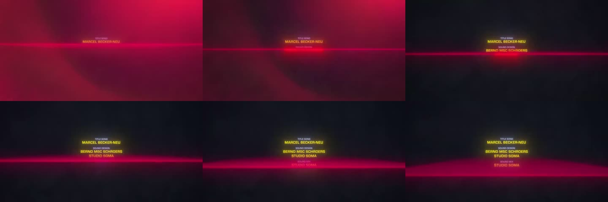

# Exposure (`exposure`)

Exposure in stops on everything below it in the stack (linear light, a true
camera exposure change). Unlike the Scene exposure, it is keyframable and
scoped: layers above it are untouched.

**D4 (background dips to black while the light line stays lit):** put the
background in a group with an Exposure layer on top, keyframe `stops`
0 → -4 over about 10 frames with the house easing; keep the light line and
credits above the group.

