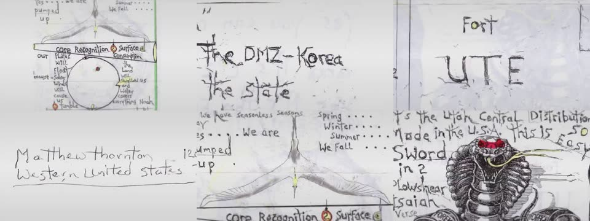

# Leave Color (`leave-color`)

Black and white except one colour range. Greys and near-greys are never
kept, so paper stays neutral.

| Param | What it does |
|---|---|
| color | The colour to keep. |
| tolerance / softness | Hue range kept around it, and its soft edge (degrees). |
| minChroma | Colours below this saturation always go grey. |
| amount | How much the rest is desaturated. |

For highlighting specific words or areas (E3), build it per shot in
HyperFrames instead.

