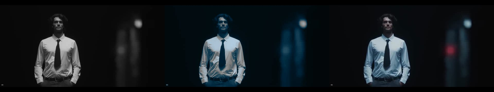
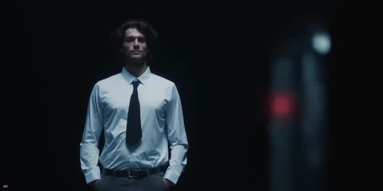

# Split Tone (`split-tone`)

Tints shadows and highlights with separate hues without changing
brightness (luma is preserved even where the tint would clip).

| Param | What it does |
|---|---|
| shadowHue / shadowSaturation | Hue (0-360°) and strength pushed into the shadows. |
| highlightHue / highlightSaturation | Same for the highlights. |
| balance | Moves the split point (negative = more of the image counts as shadow). |

True black stays black (the shadow tint fades out below ~12% luma); mid grey
at the split point is untouched; both tints reach full strength 0.3 either
side of it.

**fern CG (teal shadows, cool whites):** shadow hue 200, saturation 0.5;
highlight hue 205, saturation 0.35; balance 0. Measured on a desaturated copy
of the reference frame, shirt highlights land within ~10 levels of the
original (187/213/232 vs 197/213/229).

Left: reference frame desaturated. Middle: these settings. Right: reference.

